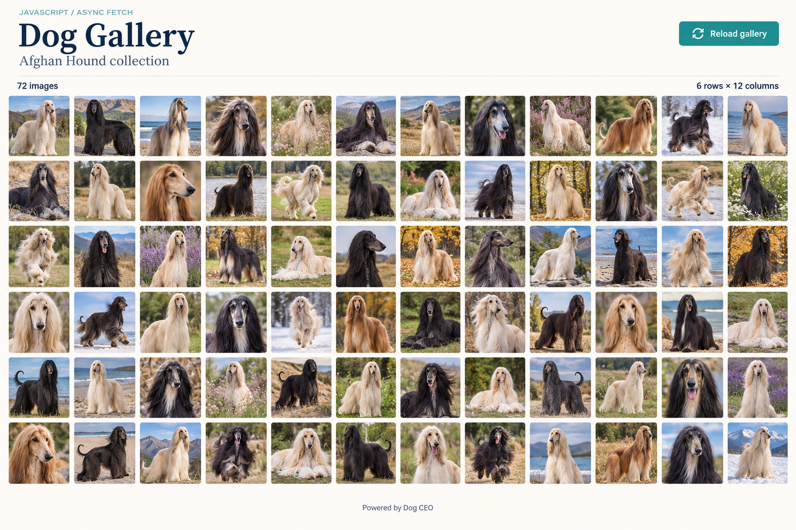

# JavaScript Assignment 3: Dog Gallery

**Topic:** Fetch API, `async`/`await`, DOM manipulation, and CSS Grid  
**Level:** Beginner to Intermediate  
**Total marks:** 100

## The problem

Build a web page that fetches dog images from the Dog CEO API and displays them in a **6 × 12 matrix**. For this assignment, that means **6 rows and 12 columns: 72 images in total** at desktop widths of 1280px and above.

Use plain HTML, CSS, and JavaScript. Make your API request with `fetch()` inside an `async` function and use `await` to handle the response. Generate the image elements using JavaScript rather than writing 72 image tags in HTML.

## Reference design



Use the reference for the page structure, image sizing, spacing, and alignment. It is an AI-generated visual guide; your actual dog photographs will come from the API and do not need to match these pictures. Exact fonts and colours are not graded.

## API to use

Read the [Dog CEO sub-breed documentation](https://dog.ceo/dog-api/documentation/sub-breed).

Use this documented endpoint to retrieve the Afghan Hound image collection:

```text
https://dog.ceo/api/breed/hound/afghan/images
```

The JSON response contains a `status` field and a `message` array of image URLs. Select 72 URLs from that array. You may take the first 72 or shuffle the array before selecting them. Do not make 72 separate API requests.

An abbreviated example of the response structure is shown below. The URL is illustrative; use the URLs returned by your request.

```json
{
  "message": ["https://images.dog.ceo/breeds/hound-afghan/example.jpg"],
  "status": "success"
}
```

If fewer than 72 URLs are returned, show a helpful message instead of silently repeating images or claiming that 72 were loaded.

## What to build

### 1. Page structure

- A heading: **Dog Gallery**.
- A subtitle: **Afghan Hound collection**.
- A **Reload gallery** button.
- A visible status area for loading, success, and error messages.
- A gallery container for the dog images.
- A footer linking to [Dog CEO](https://dog.ceo/dog-api/).

### 2. Asynchronous fetching

1. Load the gallery automatically when the page opens.
2. Write an `async` function that uses `await fetch(...)` and `await response.json()`.
3. Check `response.ok` before processing the JSON. Check that the API reports success and that `message` is an array containing usable image URLs.
4. Use `try`, `catch`, and `finally` to manage the request and restore the interface after it finishes.
5. Use a separate function to render the selected URLs into the gallery.

Do not use Axios, jQuery, a frontend framework, hard-coded dog image URLs, or `.then()` chains for the required fetching task.

### 3. Matrix layout

- At viewport widths of **1280px and above**, display exactly **12 equal-width columns and 6 rows**.
- Use CSS Grid with consistent gaps between tiles.
- Give all image tiles the same square aspect ratio. Use `object-fit: cover` so images fill their tiles without stretching.
- Keep all 72 images on one page; do not use pagination or a carousel.
- Below 1280px, allow fewer columns to keep the images readable. Keep all 72 images available and avoid horizontal page overflow.
- Add meaningful `alt` text to each image, such as `Afghan Hound photo 1`. Do not invent details about a photograph that your code has not inspected.

### 4. Loading, reload, and failure behaviour

- Show **Loading dog images...** while the API request is pending.
- Disable the reload button during the request and re-enable it when the request finishes, including after a failure.
- On success, replace the previous gallery with 72 image tiles. Reloading must not append another 72 tiles.
- Display the number of successfully loaded images. Once all images load successfully, show **72 images**. Receiving the URLs does not mean that the image files have finished loading.
- If the API request fails, show a readable error message and let the user retry using the reload button. Clear any previous gallery when a new request starts so stale images are not presented as a new result.
- If an individual image fails to load, keep its square tile and display an **Image unavailable** placeholder. Report the failure in the status area; do not count it as a successfully loaded image.
- A reload may return the same photographs. A different set is optional; a fresh request and correct replacement are required.

## Expected result checklist

Your completed submission should demonstrate all of the following:

- [ ] Opening the page automatically starts an asynchronous API request.
- [ ] The loading message is visible while waiting, and reload is disabled.
- [ ] When the API and image requests succeed, exactly 72 dog photographs appear.
- [ ] At 1280px or wider, the photographs form 6 rows and 12 columns.
- [ ] Tiles have equal dimensions, consistent spacing, and images that are not stretched.
- [ ] The page shows the gallery title, collection name, image count, reload button, and API credit.
- [ ] Reload sends a fresh request and replaces the gallery without duplicating tiles.
- [ ] A failed API request produces a visible error and leaves retry available.
- [ ] A failed image produces a placeholder without breaking the layout or inflating the loaded count.
- [ ] Narrow screens use a readable layout without horizontal overflow.
- [ ] Images have useful alternative text, and the reload button works with a keyboard and has a visible focus indicator.
- [ ] The console contains no uncaught JavaScript errors during normal use or handled failures.

## How to check your work

1. Run the page through a local development server, such as VS Code Live Server.
2. At a viewport width of at least 1280px, count the rows and columns and confirm there are 72 tiles.
3. Use the browser's Network panel to confirm a request is made to the required API endpoint.
4. Enable network throttling and reload. Check the loading message and disabled button.
5. Reload twice. Confirm that the gallery still contains 72 tiles, rather than 144 or 216.
6. With the page open, set the browser's Network panel to **Offline**, then click reload. Confirm an error appears. Restore the network and retry.
7. Temporarily replace one returned image URL in your local test data with an invalid image URL. Confirm its placeholder appears and the success count excludes it. Remove this test change before submitting.
8. Check the page at a narrow width such as 375px and navigate to the reload button using the keyboard.

## Submission requirements

Submit a GitHub repository containing:

```text
dog-gallery/
  index.html
  style.css
  app.js
  README.md
  screenshots/
    desktop.png
    mobile.png
```

Your README must include instructions for running the page, the API endpoint used, and short answers to these questions:

1. What does `await` do inside an `async` function?
2. Why do you need to await both `fetch()` and `response.json()`?
3. Why should you check `response.ok` even when using `try`/`catch`?
4. What is the difference between receiving image URLs and successfully loading the image files?
5. How do you prevent repeated reloads from creating duplicate tiles?

Include one desktop screenshot showing the full 6-row, 12-column gallery and one mobile screenshot. Be ready to explain your fetching, rendering, and error-handling code in class.

## Assessment rubric

| Criterion | Marks |
|---|---:|
| Correct use of `fetch`, `async`/`await`, and response validation | 25 |
| Dynamic rendering of 72 images and replacement on reload | 20 |
| Correct desktop matrix, consistent tiles, and responsive layout | 20 |
| Loading feedback, request errors, retry, and failed-image handling | 20 |
| Readable code, accessible images, and keyboard-friendly button | 10 |
| README answers and required screenshots | 5 |
| **Total** | **100** |

**Optional extension:** Add a sub-breed selector using the sub-breed list endpoint in the documentation. This is not required for full marks. Explain how your extension handles a collection with fewer than 72 images.
